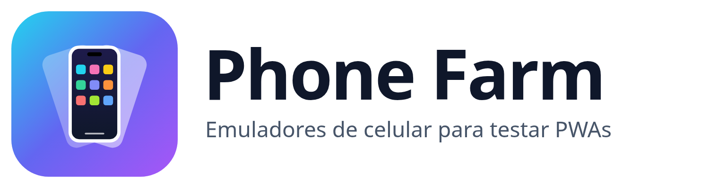

<p align="center"></p>

**Ferramenta de teste**: abre vários emuladores de celular numa janela só, para testar aplicações PWA em iPhone, Samsung, Pixel, Xiaomi e POCO sem precisar de um aparelho de verdade nem de emulador Android.
Cada celular é uma aba de navegador com moldura. Não sobe nenhum Android, então gasta mais ou menos o que uma aba do Chrome gasta por app aberto.

## Instalar

Os instaladores ficam em `release/` depois do build (veja [Gerar os instaladores](#gerar-os-instaladores)):

| Sistema | Arquivo | Como usar |
|---|---|---|
| Windows | `Phone-Farm-Setup-<versão>.exe` | Instalador; cria atalho na área de trabalho e no menu Iniciar |
| Windows | `Phone-Farm-Portable-<versão>.exe` | Executável único, roda sem instalar |
| Linux | `Phone-Farm-<versão>.AppImage` | `chmod +x` e dois cliques; roda em qualquer distro |
| Linux (Debian/Ubuntu) | `Phone-Farm-<versão>.deb` | `sudo apt install ./Phone-Farm-<versão>.deb` |

O `.exe` não é assinado: na primeira vez o Windows SmartScreen avisa; clique em "Mais informações" → "Executar assim mesmo".

## Rodar pelo código

```bash
npm install
npm start
```

## O que dá pra fazer

- **Adicionar celular**: escolhe o modelo no seletor (agrupado por marca) ou, com a tela vazia, num dos atalhos.
- **Adicionar app**: cola a URL do PWA (pode ser `localhost:5173`). O nome, o ícone, as cores e a `start_url` vêm do `manifest.json`.
- **Tela inicial**: toque no ícone pra abrir o app (ou 2 cliques, em "Abrir app com"). Clique direito no ícone fecha o app ou remove ele da lista.
- **Home** (traço no iPhone, botão redondo no SE, ◯ no Android): volta pra tela inicial. O app continua aberto em segundo plano, e no ícone aparece um pontinho.
- **◁** volta no histórico; **▢** alterna entre os apps abertos naquele celular.
- **Puxar para atualizar**: com a página no topo, arraste pra baixo com o mouse e solte depois que o indicador ficar cheio; a página recarrega. No Android aparece o círculo do Chrome; no iPhone, o spinner do Safari.
- **⋮ Mais detalhes** em cada celular: trocar modelo, girar, offline, recarregar, DevTools, fechar apps (libera memória), limpar dados (logout geral) e remover.
- **Remover todos**: apaga todos os celulares de uma vez, ou só limpa os dados de todos (logout geral) e mantém os celulares.
- **ⓘ** mostra o "Sobre".

## Modelos

| Marca | Modelos |
|---|---|
| Apple | iPhone 17 Pro Max, iPhone 17 Pro, iPhone 17, iPhone Air, iPhone 16e, iPhone 15, iPhone SE |
| Samsung | Galaxy S25 Ultra, Galaxy S25, Galaxy S23, Galaxy A56, Galaxy A14 |
| Google | Pixel 10, Pixel 8 |
| Xiaomi | Xiaomi 15, Redmi Note 14 Pro, Redmi Note 14 |
| POCO | POCO F7, POCO X7 Pro |

Os tamanhos estão em `devices.js`, em CSS px (o que o navegador do celular informa). Nos aparelhos mais novos são aproximados: resolução física ÷ DPR de fábrica.

## Isolamento

Cada celular usa a sua própria partition (`persist:<id>`), com cookies, localStorage, IndexedDB, cache e service workers separados. O login de um não aparece no outro, e tudo continua salvo quando você fecha e abre o Phone Farm.
A configuração fica em `~/.config/phone-farm/farm.json` (Linux) ou `%APPDATA%\phone-farm\farm.json` (Windows), a mesma pasta no app instalado e no `npm start`.

## Emulação

- Viewport, DPR e tamanho de tela do aparelho; o app ocupa a área entre a barra de status e a de navegação.
- Toque: o clique do mouse vira touch event, `pointer: coarse` e `ontouchstart` funcionam.
- `display-mode: standalone`: o Chromium não emula isso, então o `app-preload.js` ajusta o `matchMedia` e as regras `@media (display-mode: …)` das folhas de estilo da mesma origem, e liga o `navigator.standalone` no iPhone.
- User-Agent do aparelho, também nas popups (login com Google) e nos service workers. No Android, `navigator.userAgentData` e os headers `Sec-CH-UA-*` dizem Chrome mobile com o modelo do aparelho; no iPhone, `navigator.platform` é `iPhone` e `navigator.userAgentData` não existe, como no Safari. Os iPhones 17, Air e 16e usam o UA do iOS 26 (que congela a versão do sistema em `18_6`).
- Permissões (câmera, microfone, localização, notificações, área de transferência) são liberadas sem perguntar, como num celular em que você já deu "Permitir".
- Se o app não carregar (servidor parado, sem rede), aparece uma página de erro com "Tentar de novo" em vez de tela branca.

## Limites

- O motor é sempre Chromium, mesmo no "iPhone": o UA e o tamanho são de iPhone, mas o comportamento do Safari/WebKit (instalação, push, limites de storage) não é simulado.
- `beforeinstallprompt` não dispara, então não dá pra testar o fluxo de "Instalar app".
- Puxar para atualizar vale em todo celular, mas num PWA instalado no iPhone de verdade o Safari não tem esse gesto. Como no celular, a página pode desligar o gesto com `overscroll-behavior-y: none` (ou `contain`), e ele não dispara se o toque começar numa lista interna já rolada. No iPhone o spinner fica por cima da página, sem empurrar o conteúdo pra baixo como no Safari.
- `@media (display-mode)` em CSS de outra origem (CDN), em `@import` ou incluído depois via `insertRule` (CSS-in-JS) não é ajustado.
- O modo offline vale pro celular inteiro (a sessão), incluindo os service workers.
- Se o celular estiver cortado pela rolagem, o app fica escondido até ele aparecer inteiro na tela.
- O número de memória na barra soma todos os processos do Electron e conta bibliotecas compartilhadas mais de uma vez, então o consumo real é menor.

## Gerar os instaladores

Mesmo esquema do BVM: `electron-builder`, saída em `release/`, sem publicar (`--publish never`).

```bash
npm run electron:installer:linux    # AppImage + .deb
npm run electron:installer          # Windows (rodando no Windows)
npm run electron:installer:docker   # Windows a partir do Linux, via Docker (electronuserland/builder:wine)
npm run release                     # Linux + Windows via Docker
```

No Linux, se o terminal do VS Code tiver `ELECTRON_RUN_AS_NODE=1` (o `npm start` falha com `Cannot read properties of undefined (reading 'getPath')`), rode com `env -u ELECTRON_RUN_AS_NODE npm …`.

## Logo

A logo sai de um desenho só, em `scripts/make-logo.js`. Depois de mudar o desenho, `npm run logo` gera de novo:

- `build/icon.png` e `build/icons/*`: ícone do app e dos instaladores (o `.ico` do Windows é gerado no build);
- `renderer/logo.svg`: logo da barra de ferramentas;
- `assets/logo.png` / `assets/logo-dark.png` (e `.svg`): logomarca com o nome, para fundo claro e escuro.
